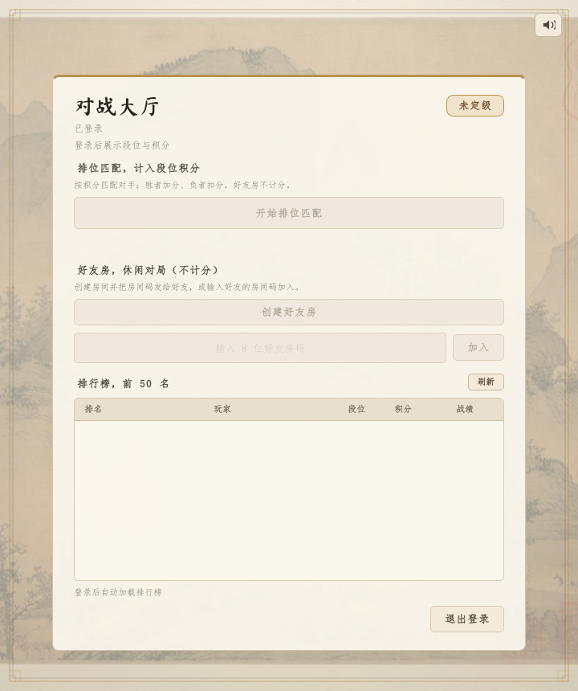
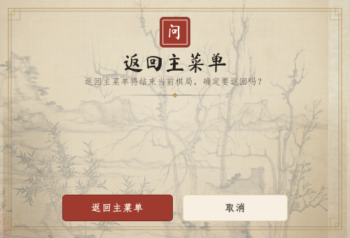

# 五子棋 · 双人 / 人机 / 联机排位

一个使用 **Python + PySide6** 编写的 Windows 桌面五子棋游戏：

- 本地双人对战；
- 四档自研 AI 人机对战（简单/中等/困难/大师），人机模式支持 AI 提示与分析；
- 11 个内置残局，全部以成语命名，玩家执先手方并与 AI 防守对战；
- 本地/AI 棋谱自动保存与逐步复盘，联机对局可从服务端读取复盘；
- 账号系统 + 公开排位快速匹配 + 自建房好友联机（FastAPI + WebSocket + SQLite/PostgreSQL 兼容）；
- Elo 积分、青铜～王者段位、排行榜、个人战绩与最近排位记录；
- 预置头像、个人信息窗口、好友申请/列表、好友私聊，以及直接邀请好友开局的休闲自建房；
- 可打包为单个 `Gomoku.exe`。

当前版本：**1.8.0**（新增头像/个人信息、好友与私聊、邀请制自建房；1.7.0 加入大师级 AI 与对局提示）。

> 联机功能需要同时运行本项目的服务端；离线双人/AI 模式不需要服务器。
> 当前仍是内测定位，注册需要用户名与密码。

## 界面预览

| 古风主菜单 | 水墨对局 |
| --- | --- |
|  |  |
| **胜利结算** | **联机大厅** |
|  |  |

返回主菜单/重新开局确认框沿用同一主题：



## 功能

### 古风视觉

- **水墨山水 + 宣纸**整体主题：主菜单、对局页和联机页共用宣纸纹理、淡墨渐晕、金线细框与朱砂印章。
- **画作**：方从义《山水墨戏》、米友仁《云山图》、陈洪绶《仿倪瓒山水》、彭序《墨梅》、
  佚名《墨竹》、盛懋《秋山行旅》，均来自克利夫兰艺术博物馆 Open Access（CC0），
  仅做运行期缩放/裁剪；详见 `gomoku/client/assets/THIRD_PARTY_NOTICES.md`。
- **字体**：标题使用 Ma Shan Zheng（马善政毛笔楷书，OFL）；正文优先使用系统
  **仿宋 FangSong / 楷体 KaiTi**，并内置 ZCOOL XiaoWei 作为跨环境中文字体回退，
  在小字号下“回”等字形更清楚。ZCOOL 字体与 OFL 文本随项目打包。
- **棋盘**：暖木棋面、深色漆框、金线、回纹角饰与朱砂“弈”印，保留黑白棋子的清晰对比。
- **终局弹窗**：胜利“胜利”（墨梅角饰）、失败“惜败”（墨竹角饰）、平局“和棋”，
  配朱砂印、书法标题、明确副标题与手数信息；取消/关闭等同“查看棋盘”。
- **确认弹窗**：返回主菜单、重新开局、更改先手方统一使用同款水墨宣纸确认框
  （朱砂“问”印、书法标题、墨线分隔），取消为默认操作，避免误触。
- **弹窗不新建窗口**：终局与确认弹窗是覆盖在主窗口之上的模态遮罩层
  （半透明墨色压暗棋盘 + 居中宣纸卡片），应用始终只有一个窗口。
- **社交界面也不新建窗口**：好友列表、个人资料、私聊与头像选择都是浮在
  联机页之上的宣纸卡片（见 `paper_panel.py`），可以同时展开多张私聊，
  任务栏始终只有一个条目。
- 所有画作、纸纹、印章、云纹均由 Qt 自绘，不依赖 QSS 图片 URL；素材缺失时自动回退纸色主题。

### 主菜单

- 启动进入居中卡片式主菜单，六个入口：**联机对战、双人对战、人机对战、残局挑战、棋谱复盘、退出游戏**。
- 双人/人机从菜单进入；人机以中等难度、玩家先手开局，进入后仍可调整难度/先手。
- “残局挑战”平铺展示 11 个关卡，每张卡的进入按钮以成语命名，并显示白先/黑先与限手数；对局页“返回”回到关卡列表。
- “棋谱复盘”打开本地棋谱复盘页，可逐步前进/后退、自动播放；联机大厅另有“最近对局”复盘入口。
- 对局页提供“返回主菜单”；有棋局时需要确认放弃，菜单页禁用 Ctrl+Z/Ctrl+N 快捷键。

### 本地模式

- 15×15 标准棋盘，黑棋先行，横、竖、两条斜线五连即胜。
- 双人 / 人机各有独立菜单入口；人机可选择玩家先手或 AI 先手。
- 简单、中等、困难、大师四档 AI，不同搜索深度、候选数和评估策略；大师档额外使用 VCF/VCT 威胁搜索、置换表和手工开局库。
- AI QThread 后台搜索，不阻塞界面；思考期间可悔棋、返回主菜单、重开或关闭。
- 人机模式提供「提示」按钮：后台分析后在棋盘上标出推荐落点，并显示搜索深度、评分与备选着法；提示不锁定棋盘输入。
- 悔棋、重新开局、终局弹窗、状态卡、最后落子、胜利连线、悬停预落子。

### 残局挑战与棋谱复盘

- **残局挑战**：内置 11 个残局（来自提供的 11 张残局图），不按难度分类；每关以成语命名（白虹贯日、双管齐下、暗度陈仓等），玩家固定执该局先手方（白先或黑先），按关卡限 4～6 手内连成五子；对手由本地 AI 防守。
  - 每关提供文字提示；不记录通关状态、使用步数或最佳成绩，挑战成功后关卡自动重置，可反复挑战。
  - 残局不提供悔棋；可“重新挑战”或“返回残局列表”。进行中的残局返回列表需要确认放弃。
  - 入口卡片为宣纸底、金线边框、朱砂小印与书法成语标题，悬停时高亮。
  - 题库坐标由 `tools/extract_puzzle_images.py` 从图片提取并人工核对；后续替换图片时可重新生成。
- **本地棋谱**：双人、人机结束后自动写入
  `%LOCALAPPDATA%\Gomoku\Gomoku\records\games.jsonl`；每局一行，损坏行会跳过，默认最多保留 1000 局。
- **棋谱复盘**：主菜单“棋谱复盘”打开最近 50 局，只读棋盘可逐手前进/后退、跳转首尾、自动播放；显示落子列表、最后一手与胜利连线。
- **联机棋谱**：大厅“最近对局”列出已结束的排位/自建房对局；双击或“复盘选中对局”从服务端拉取完整棋谱，仅对局参与者可读。

### 背景音乐与音效

- 背景音乐、落子音效和按钮点击音效使用 `gomoku/client/assets/audio/` 内置的 MP3 素材；
  开局、胜利、失败、平局音效由代码合成（素材缺失时 BGM/落子也会回退到合成音）；
- 按钮点击音效通过应用级事件过滤器覆盖所有 `QAbstractButton`；
- 主窗口和联机页共用同一个播放器；主菜单右上角、对局设置栏和联机页右上角均提供声音按钮：
  一键静音，并可分别调节背景音乐与音效音量；
- 静音和两条音量通过 `QSettings` 持久化；开启静音时 BGM 以 0 音量继续循环，
  取消静音后从当前位置恢复。

### 账号与联机

- 用户名 + 密码注册、登录、refresh token 轮换、登出；Argon2id 密码哈希。
- **公开排位快速匹配**：按当前积分选择最接近的对手，双方随机黑白；服务器权威落子、
  胜负和积分。
- **预置头像与个人信息**：点击大厅或排行榜中的头像打开个人信息浮层，查看段位、积分、
  最高分、胜负平与胜率；本人可更换 12 款古典印章头像。
- **好友与私聊**：按用户名搜索并发送好友申请，对方同意后成为好友；好友浮层显示在线状态，
  支持双方私聊，消息落库保存并支持离线补收。
- **自建房**：创建后直接从在线好友列表邀请，对方接受即开局，不再需要房间码；休闲对局不计分。
- 每手 30 秒服务器倒计时；超时由服务器判负，排位赛同样计入积分。
- 断线保留房间，客户端自动重连并恢复权威快照。
- 自建房支持认输和双方确认再战（交换黑白）；排位赛不支持同一对手直接再战，
  终局后“继续排位”会离开房间并重新进入匹配队列。
- 大厅显示当前段位、积分、最高分、胜负平、前 50 名排行榜；排行榜玩家名旁显示头像，
  点击即可查看资料。对局页显示双方积分，终局显示“积分变化”。
- 联机入口在主菜单“联机对战”，在同一窗口内切到登录页与大厅页；联机状态与离线局面互不干扰。

### 对战表情与评论

- 联机对局中可随时发送**表情**和**评论**；本地双人/人机模式不受影响。
- **表情**：点击“表情”按钮弹出表情网格（12 个预设表情），发送后像《皇室战争》
  一样在**发送方一侧**弹出——自己的表情从棋盘下方升起，对手的表情从上方落下。
- **评论**：可以手动输入，也可以从“快捷评论”菜单里挑预设文案（如“好棋！”）。
- 发送的评论会像**弹幕**一样从棋盘右侧飞向左侧，划过棋盘后淡出消失；弹幕半透明，
  不会盖住最后落子的朱砂点和胜利连线，也不拦截棋盘点击。
- **对话日志**在棋盘右侧，只记录双方的评论和表情（自己暖色、对手冷色），可查看、
  可复制，但**不能在其中发送**；离开房间或进入新对局时清空，再战时保留。
  日志**默认收起**，点击聊天栏右侧的“对话日志”按钮展开，棋盘随即占满整行；
  这个选择会被记住。发言被拒（发言太快、内容非法等）会记在日志里，日志收起时
  改用输入框的占位提示，不会混进对局的红色错误条。
- 服务器校验并限流：表情必须来自预设列表，评论最长 60 字并自动去掉换行、零宽空格
  等不可见字符；同一玩家 1.6 秒内最多 3 条。客户端另有 0.8 秒冷却，避免误触连发。
- 等待对手加入、连接中断或尚未进入对局时不能发言。
- 好友私聊独立于对局聊天：在个人信息或好友浮层点击“聊天”打开私聊浮层，支持历史记录、
  实时消息与未读提示；私聊仅限好友，单条最长 200 字并有限流。

## 段位与积分规则

- 新账号 **1200 分**，最低 100 分。
- 只有**公开快速匹配**的排位对局计分；自建房、再战和离线对局都不计分。
- 采用 Elo 期望胜率；平局按 0.5 分结算。
- K 值：前 10 局定级期 40；此后积分 <1600 为 32，1600～1999 为 24，
  ≥2000 为 16。
- 终局由服务器只结算一次，并把双方 `rating_before/after/delta` 写入
  `rating_events`，用于最近战绩和审计；服务重启后未完成对局作废，不结算积分。

| 段位 | 积分区间 |
| --- | --- |
| 青铜 | < 1100 |
| 白银 | 1100～1199 |
| 黄金 | 1200～1349（新账号起点） |
| 铂金 | 1350～1499 |
| 钻石 | 1500～1649 |
| 大师 | 1650～1799 |
| 王者 | ≥ 1800 |

排行榜按积分降序，积分相同按排位场次降序；只显示完成过至少一局排位赛的账号。

## 项目结构

> **设计原则：全局只保留一个窗口。**
> 主菜单、残局列表、离线对局、联机登录/大厅/对局、棋谱复盘都是主窗口
> 页面栈（`QStackedWidget`）里的**页**；终局弹窗与确认框是覆盖在中央
> 部件之上的**窗口内模态层**；好友、资料、私聊、头像选择是浮在联机页之上的
> **窗口内浮层**（`paper_panel.py`）。任何时刻进程内都只有一个可见的原生
> 窗口，任务栏不会出现第二个条目。

```text
Gomoku/
├── main.py                         # 薄入口：调用 gomoku.client.app.main
├── gomoku/
│   ├── shared/                     # 无 Qt，可被服务端复用
│   │   ├── rules.py                # 棋盘常量、Player/Move、胜线判定
│   │   ├── game_model.py           # 纯 Python 对局模型（含 from_moves）
│   │   ├── puzzle.py               # 残局关卡模型与校验
│   │   ├── record.py               # 棋谱 GameRecord 与校验
│   │   ├── protocol.py             # 联机协议 v1、快照校验、排位字段
│   │   ├── chat.py                 # 表情/评论预设、校验与限流常量（双端共用）
│   │   └── errors.py               # 共享错误类型
│   └── client/
│       ├── app.py                  # QApplication、配置、日志、主题字体、入口
│       ├── audio.py                # 程序化音效/BGM 合成、MP3 解码、缓存与播放管理
│       ├── assets/audio/           # BGM/落子/按钮点击 MP3 素材
│       ├── assets/ui/              # 水墨山水画作（CC0）与界面背景素材
│       ├── assets/puzzles/         # 内置残局题库 puzzles.json
│       ├── assets/fonts/           # 马善政楷书 / 站酷小薇体（OFL）与许可文本
│       ├── assets/THIRD_PARTY_NOTICES.md  # 素材与字体授权清单
│       ├── theme_palette.py        # 古风调色板
│       ├── ui_theme.py             # 主题字体、水墨背景、印章与宣纸卡片
│       ├── modal_overlay.py        # 窗口内模态遮罩层（弹窗不再新建窗口）
│       ├── result_dialog.py        # 胜利/惜败/和棋自绘弹窗
│       ├── confirm_dialog.py       # 返回主菜单/重新开局等古风确认弹窗
│       ├── sound_control.py        # 静音开关与音量滑块按钮
│       ├── constants.py            # 应用/窗口/绘制主题常量
│       ├── styles.py               # 全局 QSS
│       ├── board_view.py           # 只读 BoardView 快照
│       ├── board_widget.py         # 自绘棋盘，只消费 BoardView
│       ├── danmaku.py              # 棋盘弹幕/表情覆盖层（动画与绘制）
│       ├── chat_widgets.py         # 只读对话日志、表情选择器、快捷评论按钮
│       ├── auth.py                 # AuthUser/AuthSession（含积分字段）
│       ├── config.py               # 非敏感环境配置
│       ├── logging_setup.py        # 滚动日志与未捕获异常记录
│       ├── main_window.py          # 主菜单、离线/残局 UI、会话切换、棋谱记录
│       ├── online_panel.py         # 登录、大厅、排行榜、最近对局、联机对局 UI
│       ├── avatar_widgets.py       # 预置头像绘制、头像按钮
│       ├── paper_panel.py          # 窗口内宣纸浮层面板基类
│       ├── profile_panel.py        # 个人信息面板与头像选择器
│       ├── friends_panel.py        # 好友申请、好友列表与用户搜索
│       ├── private_chat_panel.py   # 好友私聊面板
│       ├── puzzle_bank.py          # 残局题库加载
│       ├── puzzle_card.py          # 宣纸/金线/朱砂印残局入口卡片
│       ├── puzzle_page.py          # 残局关卡选择页
│       ├── records.py              # 本地棋谱 JSONL 存储
│       ├── replay.py               # 棋谱逐帧时间线
│       ├── replay_panel.py         # 只读复盘面板
│       ├── history_records.py      # 服务端对局详情 -> GameRecord
│       ├── transport.py            # 异步传输抽象
│       ├── net/
│       │   ├── http_api.py         # QtNetwork 异步认证 REST
│       │   ├── profile_api.py      # 排位资料/排行榜异步 GET
│       │   ├── game_history_api.py # 最近对局/单局棋谱异步 GET
│       │   ├── social_api.py       # 资料/头像/好友/私聊异步 REST
│       │   └── websocket_transport.py  # QtWebSocket WSS/WS 传输
│       ├── board_geometry.py       # 棋盘直线几何与邻域候选
│       ├── zobrist.py              # 确定性 Zobrist 哈希
│       ├── transposition.py        # 有界置换表
│       ├── threat_search.py        # VCF/VCT 强制威胁搜索
│       ├── opening_book.py         # 小型手工开局库
│       ├── ai_engine.py            # 自研 AI 搜索/评估
│       ├── ai_worker.py            # AI 搜索/提示 QThread
│       └── sessions/
│           ├── base.py             # GameSession 抽象
│           ├── local.py            # 本地双人会话
│           ├── ai.py               # 人机会话
│           ├── puzzle.py           # 残局会话（限手数 + AI 防守）
│           └── online.py           # 联机/排位服务器确认状态机
├── server/                         # 独立 FastAPI 服务端
│   ├── app/
│   │   ├── ratings.py              # Elo 与段位纯函数
│   │   ├── models.py               # 账号/令牌/对局/落子/积分/好友/私聊
│   │   ├── api/auth.py             # 注册/登录/刷新/登出/me
│   │   ├── api/ranked.py           # 个人排位资料与排行榜
│   │   ├── api/users.py            # 公开资料/用户搜索/头像更新
│   │   ├── api/friends.py          # 好友申请/列表/删除
│   │   ├── api/messages.py         # 好友私聊历史/发送/已读销账
│   │   ├── api/games.py            # 最近对局与单局棋谱（仅参与者）
│   │   └── ws/rooms.py             # 自建房邀请、匹配队列、排位结算、时钟、重连
│   ├── tests/                      # REST + 双 WebSocket + Elo/社交测试
│   ├── requirements*.txt
│   ├── manage.py                   # 管理员重置密码
│   └── README.md                   # 服务端安装、部署、PostgreSQL、TLS 说明
├── tests/                          # 客户端 244 项自动化测试
├── requirements.txt                # 客户端运行依赖
├── requirements-dev.txt            # 客户端开发/打包依赖
├── README.md                       # 本文件
└── dist/
    └── Gomoku.exe                  # PyInstaller 产物
```

## 环境要求

- Windows 10 / 11（64 位）。
- 客户端：Python 3.10+，推荐 3.11～3.14。
- 当前验证环境：Windows 11、Python 3.14.7、PySide6-Essentials/Addons 6.12.0、PyInstaller 6.22.3。
- 服务端：Python 3.10+（当前机器使用 3.14.7），FastAPI、Uvicorn、SQLAlchemy async、SQLite dev / PostgreSQL prod。
- 客户端只使用官方 PySide6 包，不引入其他 GUI 库；AI、棋盘绘制和服务端通信均为自研代码。
- 本地开发数据库为 SQLite；生产建议 PostgreSQL。

## 客户端安装与运行

项目 `.venv` 已存在并安装好依赖，可直接：

```powershell
cd C:\Users\a1325\Desktop\Gomoku
.\.venv\Scripts\python.exe main.py
```

从零创建：

```powershell
py -3 -m venv .venv
.\.venv\Scripts\python.exe -m pip install -r requirements.txt
.\.venv\Scripts\python.exe main.py
```

依赖包括：

- **PySide6-Essentials**：QtCore/QtGui/QtWidgets；
- **PySide6-Addons**：QtWebSockets（联机必需）、QtMultimedia（背景音乐与音效）。

如果从 PyPI 下载慢，可以使用可信镜像：

```powershell
.\.venv\Scripts\python.exe -m pip install -i https://pypi.tuna.tsinghua.edu.cn/simple -r requirements.txt
```

## 启动联机服务端

在另一个终端中，从项目根目录运行。服务端使用独立 `server\.venv`，不要与客户端 PySide6 环境混用。

```powershell
cd C:\Users\a1325\Desktop\Gomoku
$env:GOMOKU_SERVER_ENV = "development"
$env:GOMOKU_JWT_SECRET = "replace-with-a-long-random-secret-at-least-32-chars"
server\.venv\Scripts\python.exe -m uvicorn server.app.main:app --host 127.0.0.1 --port 8000
```

- 注册只需用户名和密码，直接在客户端“联机对战”页完成，无需任何额外凭据。
- 客户端开发环境默认访问 `http://127.0.0.1:8000` 和 `ws://127.0.0.1:8000/api/v1/ws`。
- 服务端首次启动会自动在 `server/data/gomoku.db` 建表；Stage 1 旧数据库会自动补上
  `users.rating` 等积分列和 `rating_events` 表，不需要手工迁移。
- 启动本机服务后，打开客户端 → 主菜单“联机对战” → 用用户名 + 密码注册/登录 → 大厅直接
  “开始排位匹配”，或创建自建房后从好友列表邀请在线好友。
- 默认开发环境没有外部数据库；生产 PostgreSQL、TLS、部署与安全说明见
  [`server/README.md`](server/README.md)。

如果服务端不在本机，需在启动客户端前设置：

```powershell
$env:GOMOKU_API_BASE_URL = "https://your-domain.example"
$env:GOMOKU_WS_BASE_URL  = "wss://your-domain.example"
.\.venv\Scripts\python.exe main.py
```

生产必须使用 HTTPS 和 WSS，不要直接暴露开发 HTTP 服务；服务端应通过 Caddy/Nginx 终止 TLS。

## 联机操作

| 操作 | 说明 |
| --- | --- |
| 开始排位匹配 | 加入公开匹配队列，按积分寻找最接近的对手；双方随机黑白 |
| 取消匹配 | 队列等待期间可取消 |
| 排位落子 | 服务器确认后显示棋子；等待期间棋盘锁定 |
| 排位认输/超时 | 对手获胜，服务器结算 Elo 积分 |
| 继续排位 | 终局后离开当前排位房并重新匹配，不支持同一对手直接再战 |
| 创建自建房 | 房主执黑，等待好友；不计分，也不需要房间码 |
| 邀请好友 | 在等待页面点击“邀请好友”，选择在线好友；对方接受后自动开局 |
| 个人信息 | 点击大厅/排行榜/对局头像查看资料；本人可更换头像，他人可加好友或发消息 |
| 好友/私聊 | 大厅“好友”入口处理申请、查看在线状态、打开私聊浮层 |
| 认输 | 进行中可认输，对手获胜 |
| 再来一局 | 仅自建房：双方都点击申请后，服务器开新局并交换黑白 |
| 离开房间 | 等待中或终局后可用；进行中请先认输 |
| 断线重连 | 客户端自动尝试重连；服务器保留房间与时钟，恢复完整快照 |
| 表情 | 对局中点击“表情”选择预设表情，发送后在发送方一侧弹出 |
| 评论 | 手动输入或从“快捷评论”选择；发送后以弹幕形式划过棋盘后消失 |
| 对话日志 | 棋盘右侧只读面板，记录双方评论与表情，不能在其中发送；默认收起，点击“对话日志”展开 |
| 最近对局/复盘 | 大厅列出已结束的排位/自建房对局；双击或“复盘选中对局”读取完整棋谱并逐步回放 |

大厅显示当前段位/积分/最高分/战绩和排行榜；对局页顶部显示“排位赛 · 积分对局”或“自建房”、
双方昵称、执子颜色、积分与服务器时钟；排位终局会显示例如
`排位积分：1287 → 1305（+18）`。结果以页内状态和按钮展示，不在实时网络流程中弹阻塞对话框。

## 离线操作

- 双人：每步可悔一手。
- 人机：
  - AI 思考中悔棋会取消搜索并撤玩家上一手；
  - AI 已回应则撤 AI + 玩家两手；
  - AI 首手且玩家未落子时禁用悔棋；
  - 悔棋后不自动让 AI 重下。
- 快捷键：`Ctrl+Z` 悔棋，`Ctrl+N` 重新开局（仅在进入对局后生效）。
- “返回主菜单”在已有落子时会确认放弃当前棋局；确认后回到主菜单，再次进入任何模式均为新对局。

## 声音与音频缓存

- 内置素材位于 `gomoku/client/assets/audio/`：
  - `bgm.mp3`：背景音乐（约 5 分钟，`QMediaPlayer` 流式无限循环）；
  - `move.mp3`：落子音效；
  - `button.mp3`：按钮点击音效。
- 首次启动时，落子/按钮 MP3 会通过 Qt 多媒体解码为单声道 16-bit WAV，
  连同合成的开局/胜利/失败/平局音效一起缓存到
  `%LOCALAPPDATA%\Gomoku\Gomoku\cache\audio\`，之后直接复用。
  落子/按钮缓存文件名带源文件指纹，替换 MP3 后会自动重新解码；
  删除该目录可强制重建。BGM 不转码，直接流式播放。
- 素材缺失或解码失败时自动回退：BGM/落子使用程序化合成音，按钮音效静默。
- **素材授权提醒**：`bgm.mp3` 是用户提供的《画心》（常静）音频，仅适合本机个人使用；
  `move.mp3`/`button.mp3` 来自爱给网。若公开发布或分发打包后的 exe，
  请先确认音乐版权和素材站点的授权条款。
- 声音设置保存在 `HKCU\Software\Gomoku\Gomoku`：
  `audio\muted`、`audio\bgm_volume`、`audio\sfx_volume`（音量 0～100）。
- 需要用脚本/无人值守方式启动客户端时不希望出声，可设置环境变量：

```powershell
$env:GOMOKU_DISABLE_AUDIO = "1"
.\.venv\Scripts\python.exe main.py
```

  Qt 的 `offscreen`/`minimal` 平台和自动化测试也会自动禁用真实音频设备。

## 视觉素材与字体许可

- 六幅水墨画作来自克利夫兰艺术博物馆 Open Access，均为 **CC0 1.0**；
  项目仅做运行期缩放/裁剪，原始文件未修改。作品名、作者、馆藏号、来源 URL 与
  SHA-256 校验值见 [`gomoku/client/assets/THIRD_PARTY_NOTICES.md`](gomoku/client/assets/THIRD_PARTY_NOTICES.md)。
  博物馆未对本项目背书。
- 字体 Ma Shan Zheng（马善政毛笔楷书）与 ZCOOL XiaoWei（站酷小薇体）以
  **SIL Open Font License 1.1** 授权，完整许可文本位于 `gomoku/client/assets/fonts/`。
  正文优先使用 Windows 系统自带的仿宋/楷体，不随项目分发；缺少这些字体时回退到
  项目内置的 ZCOOL XiaoWei。
- 分发源码或打包后的程序时，请保留上述许可与 notices；音频素材的额外说明见上文。

## AI 四档策略

AI 完全自研，无在线接口。四档均优先检查即时五连和必防；大师档在常规搜索前额外尝试 VCF/VCT 强制胜，并使用置换表与小型手工开局库。

| 难度 | 搜索策略 | 评估方式 | 目标预算 |
| --- | --- | --- | --- |
| 简单 | 1 层局部评分，根候选约 20，前几名加权随机 | 局部攻防形状 + 即时战术 | ≤0.25 秒 |
| 中等 | alpha-beta，最大深度 3，根 12 / 内层 8 | 增量线评分、开放端、连子 | ≤0.6 秒 |
| 困难 | 迭代加深 alpha-beta，目标深度最高 5，根 16 / 内层 10 | 开放四/冲四/开放三/双威胁，较高防守权重 | ≤1.2 秒 |
| 大师 | VCF/VCT + 迭代加深 alpha-beta，目标深度最高 7，根 20 / 内层 12，置换表上限 10 万条 | 同困难 + 杀棋搜索、开局库与置换表 | ≤2.0 秒 |

人机模式的「提示」按钮复用同一引擎：后台以 1.3 秒短预算分析当前局面，返回推荐落点、评分与候选，在棋盘上以朱砂虚线标记；玩家落子、悔棋、重开或切换难度后提示自动失效。

AI 会话负责取消、暂停、过期结果过滤和 QThread 清理；在线对局不使用本地 AI 判定胜负。

## 运行自动测试

客户端：

```powershell
cd C:\Users\a1325\Desktop\Gomoku
.\.venv\Scripts\python.exe -m unittest discover -s tests -v
```

服务端：

```powershell
server\.venv\Scripts\python.exe -m unittest discover -s server/tests -v
```

客户端当前 **222 项**测试覆盖规则、AI、配置/协议、本地/AI/在线会话、排位快照/匹配队列、
程序化音频/MP3 解码/缓存/设置持久化、按钮点击滤波器、主菜单导航/返回确认、古风主题资源/
绘制、终局与确认弹窗、双人模式设置栏和离屏 UI/QThread；表情/评论协议校验与清洗、在线会话
发言冷却与信号路由、弹幕覆盖层绘制与方向、对话日志折叠与持久化；残局题库/残局会话、棋谱模型/
JSONL 存储、复盘时间线与复盘窗口测试；VCF/VCT 威胁搜索、Zobrist/置换表、开局库、大师档与
AI 提示；以及头像/个人信息、好友申请与列表、私聊历史/发送、邀请对局消息和排行榜头像 UI 测试。
服务端当前 **47 项**测试覆盖用户名 + 密码注册/登录/refresh 重放/登出、双 WebSocket 建房/邀请/加入/落子/拒绝/认输/再战、
五连终局和断线重连、快速匹配/取消、排位 Elo 结算、自建房不计分、排行榜/资料接口、积分纯函数，
最近对局/单局棋谱的参与者权限、分页和认输终局，以及头像更新、用户搜索、好友申请/同意/删除、
好友在线状态推送、私聊历史/推送和自建房邀请的接受/拒绝流程。
另已做本机真实 Uvicorn + 两个 WebSocket 客户端完整排位对局验证（1200→1220/1180，排行榜与最近战绩同步）。

UI 测试自动使用 `QT_QPA_PLATFORM=offscreen`，不启动真实网络；真实网络联机使用本机 FastAPI/WebSocket 服务端做端到端验证。

## 打包成 exe

客户端 .venv 安装构建依赖：

```powershell
pip install -r requirements-dev.txt
```

推荐用仓库自带的打包脚本（等价于下面的 pyinstaller 命令，并额外检查依赖、
打印产物大小）：

```powershell
python build.py                # 正常打包（等价 pyinstaller --noconfirm --clean Gomoku.spec）
python build.py --fast         # 跳过 --clean，复用上次缓存，打包更快
python build.py --install      # 先安装 requirements-dev.txt 依赖再打包
python build.py -- --windowed --debug   # -- 之后的参数原样透传给 PyInstaller
```

手动打包（`Gomoku.spec` 已配置 onefile/windowed，并把整个 `gomoku/client/assets` 加入 `datas`）：

```powershell
pyinstaller --noconfirm --clean Gomoku.spec
```

或使用虚拟环境解释器：

```powershell
.\.venv\Scripts\python.exe -m PyInstaller --noconfirm --clean Gomoku.spec
```

产物：

```text
dist\Gomoku.exe
```

双击即可启动离线模式。联机模式仍需要启动 `server`；exe 不会内置或自动启动服务端，开发默认连接本机 `127.0.0.1:8000`。远程服务器请通过环境变量配置后再启动 exe。

构建注意：

- PySide6-Addons 会显著增加 exe 体积；
- PyInstaller 必须收集 QtWebSockets、QtNetwork、QtMultimedia（含 FFmpeg 解码插件）及相关 DLL；
  本项目已将联机与音频模块作为静态导入，避免动态导入遗漏；
- `Gomoku.spec` 的 `datas` 会打包整个 `gomoku/client/assets/`（音频、UI 画作、OFL 字体与许可清单），
  exe 体积约增加 14MB；
- 打包后请在无开发环境的本机运行 `dist\Gomoku.exe`，确认水墨背景、书法字体、棋盘画框、
  终局弹窗以及 BGM/落子/按钮音效正常；若无声，检查 PyInstaller 是否收集了
  `PySide6/plugins/multimedia`（可增加 `hiddenimports=['PySide6.QtMultimedia']` 后重打包）；
- **分发时请把 `gomoku/client/assets/THIRD_PARTY_NOTICES.md` 和字体目录中的 OFL 文本
  一并放到 exe 旁边**，以满足 OFL 字体再分发要求；
- 生产 WSS/TLS 必须实际打包测试；本机开发使用 `ws://127.0.0.1` 只适合闭环测试。

## 日志与本地数据

客户端写滚动日志：

```text
%LOCALAPPDATA%\Gomoku\Gomoku\logs\gomoku.log
```

服务端默认 SQLite 数据：

```text
server\data\gomoku.db
```

积分变化写入 `rating_events`；对局/落子仍每手写穿数据库。日志和接口都不记录密码、
Authorization 头或 token。当前客户端 token 只保存在内存，关闭应用后需要重新登录；
后续可用 Windows DPAPI 安全保存 refresh token。

## 安全与限制

- 联机采用服务器权威落子、每手 DB 写穿、房间异步锁、唯一步序/客户端 move_id 幂等、
  服务器时钟和终局一次性 Elo 结算；客户端不能提交胜负或积分。
- 账号使用用户名 + 密码注册、Argon2id 密码哈希、短时 JWT access + 服务端哈希存储且轮换的
  refresh token；登录失败只返回通用错误，不按失败次数锁定账号或 IP。
- 联机棋谱接口只允许对局参与者读取；暂不提供公开分享、观战或第三方导出。
- 只有公开匹配计分，自建房和再战不计分，排位房只能匹配加入、排位终局不能直接再战，
  但这些措施不能完全杜绝排队串通、故意送分或外部 AI 辅助；当前不作为严格竞技排位运营。
- 匹配队列和房间状态在单进程内存中；生产只能运行一个 Uvicorn worker，多实例需要
  Redis/房间路由。服务重启会作废未完成对局，不结算积分。
- 生产必须固定高强度 `GOMOKU_JWT_SECRET`、使用 HTTPS/WSS、限制服务端访问并做好备份；
  开发默认 SQLite、单 Uvicorn worker。
- 当前没有邮箱验证、账号删除/导出、赛季、举报、反作弊回放审计或未成年人保护机制。
- 公开在中国大陆上线前，应独立评估 ICP/公安备案、个人信息保护、实名/防沉迷和网络游戏
  出版审批等要求。

## 下一阶段

后续可继续实现：更完整的 VCT 证明与跨手置换表调优、残局题库扩充与通关进度、
安装包/代码签名/自动更新、赛季与段位衰减、Glicko-2 取代 Elo、Redis 多实例房间/匹配、
开局规则（禁手/交换）、举报与对局回放审计、账号举报/处罚、邮箱验证与 token 安全持久化。
