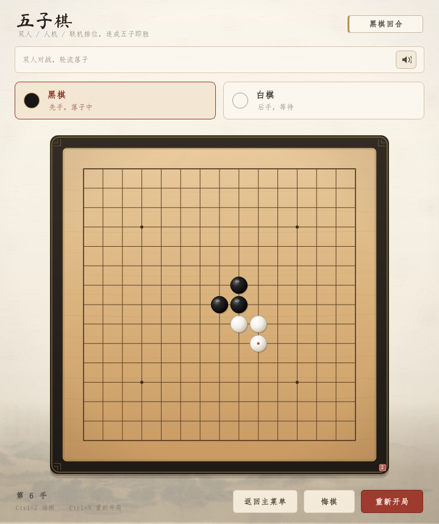
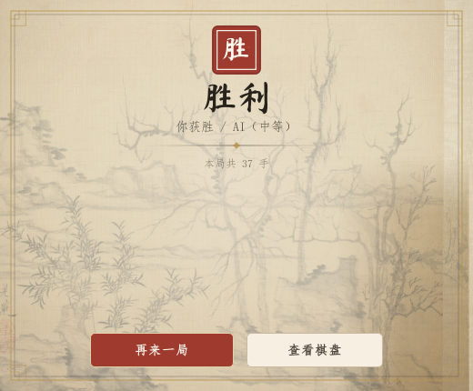

# 五子棋 · 双人 / 人机 / 联机排位

[](https://github.com/ckm6666/Gomoku/actions/workflows/ci.yml)

一个使用 **Python + PySide6** 编写的 Windows 桌面五子棋游戏：

- 本地双人对战；
- 四档自研 AI 人机对战（简单/中等/困难/大师），人机模式支持 AI 提示与分析；
- 11 个内置残局，全部以成语命名，玩家执先手方并与 AI 防守对战；
- 本地/AI 棋谱自动保存与逐步复盘，联机对局可从服务端读取复盘；
- 账号系统 + 公开排位快速匹配 + 自建房好友联机（FastAPI + WebSocket + SQLite/PostgreSQL 兼容）；
- **对战广场与观战**：独立的“对战广场”页面集中列出所有进行中的对局，任何第三方账号都能进入旁观，实时同步棋盘但不能操作；
- **沙盘推演**：联机对局中可打开独立的沙盘棋盘，自行执黑执白推演后续变化，沙盘完全在本地运行，不影响真实对局；
- **Glicko-2 积分**、青铜～王者段位、排行榜、个人战绩与最近排位记录；
- **排位赛季**：赛季到期自动归档并软重置积分，展示赛季排名与历史赛季排行榜；
- **总时长/Fischer 时钟**：自建房可选每手倒计时或“总时长 + 每手加秒”，排位固定每手 30 秒；
- **举报与回放审计**：对局结束后可举报对手，管理员结合落子序列、终局一致性与时间特征复核；
- **记住密码**：登录页可勾选记住账号密码，密码用 Windows DPAPI 加密后只保存在本机；
- **AI 复盘**：复盘页逐手分析推荐着法、评分损失、失误/败着标注与整局准确率；
- 预置印章头像与本地图片上传头像、个人信息窗口、好友申请/列表、好友私聊，以及直接邀请好友开局的休闲自建房；
- 排位成就系统与十三枚勋章：胜场、连胜、段位里程碑；对局双方卡片直接展示勋章；
- 可打包为单个 `Gomoku.exe`。

当前版本：**1.12.0**（新增登录页“记住密码”与排位固定每手 30 秒，打包版默认连固定公网入口；1.11.0 加入 Fischer 总时长时钟、Glicko-2 与排位赛季、举报与回放审计、AI 复盘分析；1.10.0 加入对战广场与观战；1.9.0 加入自定义头像上传、成就/勋章系统与对局勋章展示）。

> 联机功能需要同时运行本项目的服务端；离线双人/AI 模式不需要服务器。
> 当前仍是内测定位，注册需要用户名与密码。

## 界面预览

| 古风主菜单 | 水墨对局 |
| --- | --- |
|  |  |
| **胜利结算** | **联机大厅** |
|  |  |

返回主菜单/重新开局确认框沿用同一主题：


## 功能

### 古风视觉

- **水墨山水 + 宣纸**整体主题：主菜单、对局页和联机页共用宣纸纹理、淡墨渐晕、金线细框与朱砂印章。
- **画作**：方从义《山水墨戏》、米友仁《云山图》、陈洪绶《仿倪瓒山水》、彭序《墨梅》、
  佚名《墨竹》、盛懋《秋山行旅》，均来自克利夫兰艺术博物馆 Open Access（CC0），
  仅做运行期缩放/裁剪；详见 `gomoku/client/assets/THIRD_PARTY_NOTICES.md`。
- **字体**：标题使用 Ma Shan Zheng（马善政毛笔楷书，OFL）；正文优先使用系统
  **仿宋 FangSong / 楷体 KaiTi**，并内置 ZCOOL XiaoWei 作为跨环境中文字体回退，
  在小字号下“回”等字形更清楚。ZCOOL 字体与 OFL 文本随项目打包。
- **棋盘**：暖木棋面、深色漆框、金线、回纹角饰与朱砂“弈”印，保留黑白棋子的清晰对比。
- **终局弹窗**：胜利“胜利”（墨梅角饰）、失败“惜败”（墨竹角饰）、平局“和棋”，
  配朱砂印、书法标题、明确副标题与手数信息；取消/关闭等同“查看棋盘”。
- **确认弹窗**：返回主菜单、重新开局、更改先手方统一使用同款水墨宣纸确认框
  （朱砂“问”印、书法标题、墨线分隔），取消为默认操作，避免误触。
- **弹窗不新建窗口**：终局与确认弹窗是覆盖在主窗口之上的模态遮罩层
  （半透明墨色压暗棋盘 + 居中宣纸卡片），应用始终只有一个窗口。
- **社交界面也不新建窗口**：好友列表、个人资料、私聊与头像选择都是浮在
  联机页之上的宣纸卡片（见 `paper_panel.py`），可以同时展开多张私聊，
  任务栏始终只有一个条目。
- 所有画作、纸纹、印章、云纹均由 Qt 自绘，不依赖 QSS 图片 URL；素材缺失时自动回退纸色主题。

### 主菜单

- 启动进入居中卡片式主菜单，六个入口：**联机对战、双人对战、人机对战、残局挑战、棋谱复盘、退出游戏**。
- 双人/人机从菜单进入；人机以中等难度、玩家先手开局，进入后仍可调整难度/先手。
- “残局挑战”平铺展示 11 个关卡，每张卡的进入按钮以成语命名，并显示白先/黑先与限手数；对局页“返回”回到关卡列表。
- “棋谱复盘”打开本地棋谱复盘页，可逐步前进/后退、自动播放；联机大厅另有“最近对局”复盘入口。
- 对局页提供“返回主菜单”；有棋局时需要确认放弃，菜单页禁用 Ctrl+Z/Ctrl+N 快捷键。

### 本地模式

- 15×15 标准棋盘，黑棋先行，横、竖、两条斜线五连即胜。
- 双人 / 人机各有独立菜单入口；人机可选择玩家先手或 AI 先手。
- 简单、中等、困难、大师四档 AI，不同搜索深度、候选数和评估策略；大师档额外使用 VCF/VCT 威胁搜索、置换表和手工开局库。
- AI QThread 后台搜索，不阻塞界面；思考期间可悔棋、返回主菜单、重开或关闭。
- 人机模式提供「提示」按钮：后台分析后在棋盘上标出推荐落点，并显示搜索深度、评分与备选着法；提示不锁定棋盘输入。
- 悔棋、重新开局、终局弹窗、状态卡、最后落子、胜利连线、悬停预落子。

### 残局挑战与棋谱复盘

- **残局挑战**：内置 11 个残局（来自提供的 11 张残局图），不按难度分类；每关以成语命名（白虹贯日、双管齐下、暗度陈仓等），玩家固定执该局先手方（白先或黑先），按关卡限 4～6 手内连成五子；对手由本地 AI 防守。
  - 每关提供文字提示；不记录通关状态、使用步数或最佳成绩，挑战成功后关卡自动重置，可反复挑战。
  - 残局不提供悔棋；可“重新挑战”或“返回残局列表”。进行中的残局返回列表需要确认放弃。
  - 入口卡片为宣纸底、金线边框、朱砂小印与书法成语标题，悬停时高亮。
  - 题库坐标由 `tools/extract_puzzle_images.py` 从图片提取并人工核对；后续替换图片时可重新生成。
  - **每日残局**：残局页顶部按日期固定选择一题，记录连续通关天数；同一天重复通关不增加，
    漏掉一天后从 1 重新开始。
- **本地棋谱**：双人、人机结束后自动写入
  `%LOCALAPPDATA%\Gomoku\Gomoku\records\games.jsonl`；每局一行，损坏行会跳过，默认最多保留 1000 局。
- **棋谱复盘**：主菜单“棋谱复盘”打开最近 50 局，只读棋盘可逐手前进/后退、跳转首尾、自动播放；显示落子列表、最后一手与胜利连线。
  复盘页支持 **SGF 导入/导出**：可导出当前棋谱为 15 路 SGF，也可导入单主变化的 SGF 棋谱直接复盘。
- **AI 复盘**：复盘页“AI 复盘”在后台逐手分析，给出 AI 推荐着法、实战评分、胜率与损失，
  并把每手标为“最佳/好棋/一般/失误/败着”；顶部显示整局准确率与失误统计。分析可随时取消，
  结果只保存在本次复盘页，不上传服务器。联机与本地棋谱都可以使用。
- **对局审计**：联机复盘可通过参与者审计接口检查落子编号、黑白交替、座位归属、终局结果与
  时间异常；举报面板会先显示该局的审计摘要，管理员复核时也能看到完整审计结果。
- **联机棋谱**：大厅“最近对局”列出已结束的排位/自建房对局；双击或“复盘选中对局”从服务端拉取完整棋谱，仅对局参与者可读。

### 背景音乐与音效

- 背景音乐、落子音效和按钮点击音效使用 `gomoku/client/assets/audio/` 内置的 MP3 素材；
  开局、胜利、失败、平局音效由代码合成（素材缺失时 BGM/落子也会回退到合成音）；
- 按钮点击音效通过应用级事件过滤器覆盖所有 `QAbstractButton`；
- 主窗口和联机页共用同一个播放器；主菜单右上角、对局设置栏和联机页右上角均提供声音按钮：
  一键静音，并可分别调节背景音乐与音效音量；
- 静音和两条音量通过 `QSettings` 持久化；开启静音时 BGM 以 0 音量继续循环，
  取消静音后从当前位置恢复。

### 账号与联机

- 用户名 + 密码注册、登录、refresh token 轮换、登出；Argon2id 密码哈希。
- 登录页可勾选 **记住密码**：密码使用 Windows DPAPI 按当前 Windows 用户加密后保存在本机，
  下次启动自动填充账号与密码，退出登录后回到登录页也会重新填入；取消勾选会立即删除已保存的
  凭据，非 Windows 平台不保存密码，只记住用户名。
- **公开排位快速匹配**：按当前积分选择最接近的对手，双方随机黑白；排位赛固定
  **每手 30 秒**，不提供自定义时限；服务器权威落子、时钟、胜负和积分。
- **排位赛季与 Glicko-2**：积分、评分不确定度（RD）和波动率由服务器用 Glicko-2 结算；
  每个赛季结束后自动归档最终积分并软重置（保留一半偏离量、提高 RD），大厅显示赛季名称、
  剩余天数与赛季排名；历史赛季可在接口查看归档排行榜。
- **头像与个人信息**：点击大厅或排行榜中的头像打开个人信息浮层，查看段位、积分、
  最高分、胜负平、胜率与已获勋章；本人可在 12 款古典印章中切换，或上传一张本地
  JPEG/PNG 图片作为头像（客户端自动裁成 192×192 方形并压缩，服务端校验格式/体积/
  尺寸；选择印章会移除自定义图片）。
- **成就与勋章**：排位胜场、最高连胜与历史最高段位会解锁“初捷/十胜/廿五胜/五十胜/
  百胜”“三连捷/五连捷/十连捷”“金榜/铂金/钻石/大师/王者”共 13 枚勋章。资料浮层显示
  最稀有的几枚与“全部成就”入口；联机对局页双方玩家卡片按稀有度展示最多 3 枚勋章，
  排位终局还会提示本局新解锁的成就。
- **好友与私聊**：按用户名搜索并发送好友申请，对方同意后成为好友；好友浮层显示在线状态，
  支持双方私聊，消息落库保存并支持离线补收。
- **自建房**：创建后直接从在线好友列表邀请，对方接受即开局，不再需要房间码；休闲对局不计分。
  创建时可选择每手 15/30/60/90 秒或 Fischer 总时长，并可关闭“允许观战”；关闭后该局不会出现在
  对战广场，也不能被第三方旁观。
- **对战广场**：大厅右上角的“对战广场”按钮进入独立页面，列出允许观战的进行中对局
  （双方昵称、模式、手数）。服务器在开局与终局时推送“对局列表变了”，页面据此即时增删条目，
  另有定时兜底刷新；断线期间的推送不会丢。
- **观战**：在对战广场点“观战”即可进入旁观；观战者实时同步棋盘、回合与倒计时，但不能落子、
  认输、悔棋、再战、发言或邀请好友，对局双方也不会被打扰；点“退出观战”回到对战广场。
  每局观战人数有上限，避免热门对局拖慢落子广播。
- **沙盘推演**：对局页底部操作栏的“沙盘推演”按钮会在真实棋盘上覆盖一层独立的沙盘棋盘，
  用户在沙盘上自行执黑、执白推演后续变化。沙盘提供“黑棋/白棋”切换、“撤销”与
  “回到当前局面”三个操作，随时可以丢弃推演、回到真实局面的基线。
  沙盘完全在本地运行：不发送任何落子请求，也不修改真实对局的权威状态，
  真实对局在后台照常进行；对手落子后沙盘会提示“对局已更新”，点“回到当前局面”
  即可重新载入最新局面。排位赛、自建房与观战都可以使用沙盘。
- 排位赛固定每手 30 秒服务器倒计时；创建自建房时可选 15/30/60/90 秒，
  也可选择 **Fischer 时钟**（总时长 + 每手加秒，例如 5 分 + 3 秒）。Fischer 模式下双方各自
  拥有一份余量，落子后扣除本手耗时并加回固定秒数；余量耗尽由服务器判负。对局页同时显示
  双方余量，观战者也看得到。
- 联机支持**悔棋请求**：只能在自己回合发起，每方每局有次数上限且两次请求之间有冷却；
  服务器把请求转给对手，对手同意后撤销请求者最后一手及其后的应手，拒绝或 30 秒未回应
  则棋盘保持不变。
- 认输需要二次确认；排位中掉线、超时和认输都会计入服务器结算。
- 断线保留房间，客户端自动重连并恢复权威快照；掉线超过 20 秒仍未重连则判对手
  获胜（逃跑），排位赛同样结算积分。
- 自建房支持认输和双方确认再战（交换黑白）；排位赛不支持同一对手直接再战，
  终局后“继续排位”会离开房间并重新进入匹配队列。
- 对手认输或逃跑时，获胜方会看到对应的胜利提示弹窗。
- 对局结束后可点“举报对手”，选择作弊/AI 辅助、辱骂、拖延或其他类别并补充说明；
  每局每人只能举报一次。面板会先展示该局的回放审计摘要（异常数量与主要问题），
  举报进入管理员待处理列表，管理员可驳回、警告或标记成立并留下处理备注。
- 大厅显示当前赛季、赛季排名、段位、积分、最高分、胜负平、前 50 名排行榜；排行榜玩家名旁
  显示头像，点击即可查看资料。对局页显示双方积分，终局显示“积分变化”。
- 联机入口在主菜单“联机对战”，在同一窗口内切到登录页与大厅页；联机状态与离线局面互不干扰。

### 对战表情与评论

- 联机对局中可随时发送**表情**和**评论**；本地双人/人机模式不受影响。
- **表情**：点击“表情”按钮弹出表情网格（12 个预设表情），发送后像《皇室战争》
  一样在**发送方一侧**弹出——自己的表情从棋盘下方升起，对手的表情从上方落下。
- **评论**：可以手动输入，也可以从“快捷评论”菜单里挑预设文案（如“好棋！”）。
- 发送的评论会像**弹幕**一样从棋盘右侧飞向左侧，划过棋盘后淡出消失；弹幕半透明，
  不会盖住最后落子的朱砂点和胜利连线，也不拦截棋盘点击。
- **对话日志**在棋盘右侧，只记录双方的评论和表情（自己暖色、对手冷色），可查看、
  可复制，但**不能在其中发送**；离开房间或进入新对局时清空，再战时保留。
  日志**默认收起**，点击聊天栏右侧的“对话日志”按钮展开，棋盘随即占满整行；
  这个选择会被记住。发言被拒（发言太快、内容非法等）会记在日志里，日志收起时
  改用输入框的占位提示，不会混进对局的红色错误条。
- 服务器校验并限流：表情必须来自预设列表，评论最长 60 字并自动去掉换行、零宽空格
  等不可见字符；同一玩家 1.6 秒内最多 3 条。客户端另有 0.8 秒冷却，避免误触连发。
- 等待对手加入、连接中断或尚未进入对局时不能发言。
- 好友私聊独立于对局聊天：在个人信息或好友浮层点击“聊天”打开私聊浮层，支持历史记录、
  实时消息与未读提示；私聊仅限好友，单条最长 200 字并有限流。

## 段位与积分规则

- 新账号 **1200 分**，最低 100 分；初始 RD 100、波动率 0.06。
- 只有**公开快速匹配**的排位对局计分；自建房、再战和离线对局都不计分。
- 采用 **Glicko-2** 结算：每局根据双方积分、RD、波动率与期望得分更新；平局按 0.5 分。
  RD 越低表示水平越确定，积分变化越小；新账号与赛季回归账号的 RD 更高，定级更快。
- 终局由服务器只结算一次，并把双方 `rating_before/after/delta`、RD/波动率变化与赛季归属
  写入 `rating_events`，用于最近战绩和审计；服务重启后未完成对局作废，不结算积分。
- **赛季**：默认 90 天（`GOMOKU_SEASON_LENGTH_DAYS`）。赛季结束时把参赛账号的最终积分写入
  `season_ratings` 归档，然后按“保留一半偏离量”软重置积分（1600 → 1400）并把 RD 抬高到
  至少 120；生涯胜场/连胜/勋章不重置，当前连胜清零。大厅与资料接口显示赛季名称、剩余天数
  和赛季排名；`GET /api/v1/seasons/{number}/leaderboard` 可查看历史赛季归档排行榜。
- 举报仅限已结束对局的参与者，每局每人一次；回放审计校验落子编号/颜色/座位/坐标、重放胜者
  与记录是否一致，以及时间倒流、终局后落子和大量“秒回”式响应。管理员白名单由
  `GOMOKU_ADMIN_USERNAMES` 配置，复核接口只记录处理结果，不自动封号。

| 段位 | 积分区间 |
| --- | --- |
| 青铜 | < 1100 |
| 白银 | 1100～1199 |
| 黄金 | 1200～1349（新账号起点） |
| 铂金 | 1350～1499 |
| 钻石 | 1500～1649 |
| 大师 | 1650～1799 |
| 王者 | ≥ 1800 |

排行榜按积分降序，积分相同按排位场次降序；只显示完成过至少一局排位赛的账号。

## 成就与勋章

成就由账号已有的排位统计**实时推导**，服务端不单独维护一张“解锁记录表”：

| 类别 | 勋章 | 条件 |
| --- | --- | --- |
| 胜场 | 初捷 / 十胜 / 廿五胜 / 五十胜 / 百胜 | 排位赛累计胜场 1 / 10 / 25 / 50 / 100 |
| 连胜 | 三连捷 / 五连捷 / 十连捷 | 排位赛历史最高连胜 3 / 5 / 10 |
| 段位 | 金榜 / 铂金 / 钻石 / 大师 / 王者 | 历史最高积分达到 1200 / 1350 / 1500 / 1650 / 1800 |

- 只统计**公开快速匹配**的排位对局；自建房、再战和离线对局不更新胜场/连胜。
- 段位成就按**历史最高积分**计算，掉分不会失去已经获得的勋章。
- 新账号从 1200 分（黄金）起步，因此一开始就拥有“金榜”勋章。
- 每局排位结算时服务器同时更新 `current_win_streak` / `best_win_streak`，并在终局
  快照里给出 `your_new_achievements`，客户端只提示一次“新成就解锁”。
- 对局中双方玩家卡片按稀有度展示最多 3 枚勋章；资料浮层展示最多 6 枚，并可打开
  完整成就墙查看未解锁勋章的进度。
- 客户端与服务端共用 `gomoku/shared/achievements.py` 的同一份定义，避免两端规则漂移。

## 项目结构

> **设计原则：全局只保留一个窗口。**
> 主菜单、残局列表、离线对局、联机登录/大厅/对局、棋谱复盘都是主窗口
> 页面栈（`QStackedWidget`）里的**页**；终局弹窗与确认框是覆盖在中央
> 部件之上的**窗口内模态层**；好友、资料、私聊、头像选择是浮在联机页之上的
> **窗口内浮层**（`paper_panel.py`）。任何时刻进程内都只有一个可见的原生
> 窗口，任务栏不会出现第二个条目。

```text
Gomoku/
├── main.py                         # 薄入口：调用 gomoku.client.app.main
├── gomoku/
│   ├── shared/                     # 无 Qt，可被服务端复用
│   │   ├── rules.py                # 棋盘常量、Player/Move、胜线判定
│   │   ├── game_model.py           # 纯 Python 对局模型（含 from_moves）
│   │   ├── puzzle.py               # 残局关卡模型与校验
│   │   ├── record.py               # 棋谱 GameRecord 与校验
│   │   ├── sgf.py                  # 15 路 SGF 棋谱导入/导出
│   │   ├── protocol.py             # 联机协议 v1、快照校验、排位/成就/时钟字段
│   │   ├── time_control.py         # 每手/Fischer 时限模型、校验与预设（双端共用）
│   │   ├── capabilities.py         # 协议能力协商常量与校验（双端共用）
│   │   ├── avatar.py               # 预置印章、自定义头像尺寸/体积约束（双端共用）
│   │   ├── achievements.py         # 成就目录、解锁条件与进度推导（双端共用）
│   │   ├── chat.py                 # 表情/评论预设、校验与限流常量（双端共用）
│   │   └── errors.py               # 共享错误类型
│   └── client/
│       ├── app.py                  # QApplication、配置、日志、主题字体、入口
│       ├── audio.py                # 程序化音效/BGM 合成、MP3 解码、缓存与播放管理
│       ├── assets/audio/           # BGM/落子/按钮点击 MP3 素材
│       ├── assets/ui/              # 水墨山水画作（CC0）与界面背景素材
│       ├── assets/puzzles/         # 内置残局题库 puzzles.json
│       ├── assets/fonts/           # 马善政楷书 / 站酷小薇体（OFL）与许可文本
│       ├── assets/THIRD_PARTY_NOTICES.md  # 素材与字体授权清单
│       ├── theme_palette.py        # 古风调色板
│       ├── ui_theme.py             # 主题字体、水墨背景、印章与宣纸卡片
│       ├── modal_overlay.py        # 窗口内模态遮罩层（弹窗不再新建窗口）
│       ├── result_dialog.py        # 胜利/惜败/和棋自绘弹窗
│       ├── confirm_dialog.py       # 返回主菜单/重新开局等古风确认弹窗
│       ├── sound_control.py        # 静音开关与音量滑块按钮
│       ├── constants.py            # 应用/窗口/绘制主题常量
│       ├── styles.py               # 全局 QSS
│       ├── board_view.py           # 只读 BoardView 快照
│       ├── board_widget.py         # 自绘棋盘，只消费 BoardView
│       ├── danmaku.py              # 棋盘弹幕/表情覆盖层（动画与绘制）
│       ├── chat_widgets.py         # 只读对话日志、表情选择器、快捷评论按钮
│       ├── auth.py                 # AuthUser/AuthSession（含积分字段）
│       ├── credential_store.py     # 记住密码：Windows DPAPI 加密保存/读取凭据
│       ├── config.py               # 非敏感环境配置、联机地址解析与内置公网入口
│       ├── frozen.py               # 打包产物（PyInstaller）运行状态探测
│       ├── logging_setup.py        # 滚动日志与未捕获异常记录
│       ├── main_window.py          # 主菜单、离线/残局 UI、会话切换、棋谱记录
│       ├── online_panel.py         # 联机页面编排、网络/会话/UI 同步
│       ├── online_pages/           # 联机页面构建器
│       │   ├── auth_page.py        # 登录/注册页
│       │   ├── lobby_page.py       # 大厅、排位入口、排行榜、最近对局
│       │   ├── game_page.py        # 对局/观战页棋盘、聊天与操作栏
│       │   ├── plaza_page.py       # 对战广场（进行中对局列表/刷新/观战入口）
│       │   └── common.py           # 页面共用常量与空棋盘快照
│       ├── online_player_card.py   # 联机对局玩家身份卡（头像/执子/积分/勋章）
│       ├── avatar_widgets.py       # 预置/自定义头像绘制、头像按钮
│       ├── avatar_images.py        # 自定义头像缓存、异步下载与上传前裁切编码
│       ├── achievement_widgets.py  # 勋章绘制与完整成就墙浮层
│       ├── paper_panel.py          # 窗口内宣纸浮层面板基类
│       ├── profile_panel.py        # 个人信息、勋章概览与头像选择/上传
│       ├── friends_panel.py        # 好友申请、好友列表与用户搜索
│       ├── private_chat_panel.py   # 好友私聊面板
│       ├── puzzle_bank.py          # 残局题库加载
│       ├── daily_puzzle.py         # 每日残局选择与连续通关进度
│       ├── puzzle_card.py          # 宣纸/金线/朱砂印残局入口卡片
│       ├── puzzle_page.py          # 残局关卡选择页
│       ├── records.py              # 本地棋谱 JSONL 存储
│       ├── replay.py               # 棋谱逐帧时间线
│       ├── replay_panel.py         # 只读复盘面板 + AI 复盘进度/标注
│       ├── review.py               # AI 复盘评分、损失阈值与整局统计
│       ├── review_worker.py        # AI 复盘后台 QThread
│       ├── report_panel.py         # 对局举报浮层（类别/说明/审计摘要）
│       ├── sandbox.py              # 沙盘推演模型（真实局面分叉 + 本地落子）
│       ├── sandbox_panel.py        # 沙盘推演面板（覆盖真实棋盘）
│       ├── history_records.py      # 服务端对局详情 -> GameRecord
│       ├── transport.py            # 异步传输抽象
│       ├── net/
│       │   ├── http_api.py         # QtNetwork 异步认证 REST
│       │   ├── profile_api.py      # 排位资料/排行榜异步 GET
│       │   ├── game_history_api.py # 最近对局/单局棋谱异步 GET
│       │   ├── report_api.py       # 举报提交与对局审计异步 REST
│       │   ├── social_api.py       # 资料/头像/好友/私聊异步 REST
│       │   └── websocket_transport.py  # QtWebSocket WSS/WS 传输
│       ├── board_geometry.py       # 棋盘直线几何与邻域候选
│       ├── zobrist.py              # 确定性 Zobrist 哈希
│       ├── transposition.py        # 有界置换表
│       ├── threat_search.py        # VCF/VCT 强制威胁搜索
│       ├── opening_book.py         # 小型手工开局库
│       ├── ai_engine.py            # 自研 AI 搜索/评估
│       ├── ai_worker.py            # AI 搜索/提示 QThread
│       └── sessions/
│           ├── base.py             # GameSession 抽象
│           ├── local.py            # 本地双人会话
│           ├── ai.py               # 人机会话
│           ├── puzzle.py           # 残局会话（限手数 + AI 防守）
│           ├── online_state.py     # 联机高层阶段枚举（lobby/queued/waiting/playing/spectating）
│           └── online.py           # 联机/排位服务器确认状态机
├── server/                         # 独立 FastAPI 服务端
│   ├── app/
│   │   ├── glicko2.py              # Glicko-2 积分/波动率纯函数
│   │   ├── ratings.py              # 积分结算封装、段位与赛季软重置
│   │   ├── seasons.py              # 赛季推进、归档与当前赛季信息
│   │   ├── audit.py                # 回放审计（序列/结果/时间异常）
│   │   ├── achievement_service.py  # 由账号统计推导成就的服务端辅助
│   │   ├── avatar_service.py       # 自定义头像 data URL 校验/解码
│   │   ├── migrations.py           # 启动时执行 Alembic upgrade / 旧库登记基线
│   │   ├── metrics.py              # Prometheus 指标与房间状态 collector
│   │   ├── observability.py        # 结构化日志、请求 ID、用户上下文
│   │   ├── models.py               # 账号/令牌/对局/落子/积分/赛季/举报/好友/私聊
│   │   ├── api/auth.py             # 注册/登录/刷新/登出/me
│   │   ├── api/ranked.py           # 个人排位资料、赛季排名与排行榜
│   │   ├── api/seasons.py          # 当前赛季与历史赛季归档排行榜
│   │   ├── api/reports.py          # 举报提交/我的举报/管理员复核
│   │   ├── api/users.py            # 公开资料/用户搜索/头像更新
│   │   ├── api/friends.py          # 好友申请/列表/删除
│   │   ├── api/messages.py         # 好友私聊历史/发送/已读销账
│   │   ├── api/games.py            # 最近对局/单局棋谱/参与者审计/对局列表（观战入口）
│   │   └── ws/
│   │       ├── entities.py         # 连接/房间/邀请/队列纯数据实体
│   │       ├── limits.py           # 命令令牌桶与单 IP 连接配额
│   │       └── rooms.py            # 自建房邀请、匹配队列、排位结算、时钟、重连、观战
│   ├── migrations/                 # Alembic 版本化迁移（0001_baseline、0002 赛季/Glicko/举报）
│   ├── alembic.ini                 # 迁移脚本路径与数据库 URL 占位
│   ├── Dockerfile                  # 服务端生产镜像（非 root、健康检查）
│   ├── tests/                      # REST + 双/三 WebSocket + Glicko-2/赛季/举报/审计/社交/观战/迁移测试
│   ├── requirements*.txt
│   ├── manage.py                   # 管理员重置密码
│   └── README.md                   # 服务端安装、部署、PostgreSQL、TLS 说明
├── tests/                          # 客户端 355 项自动化测试
├── requirements.txt                # 客户端运行依赖（人工维护的版本范围）
├── requirements.lock               # 客户端运行依赖锁定（含哈希）
├── requirements-tools.txt          # ruff / mypy / coverage 工具依赖
├── requirements-tools.lock         # 工具依赖锁定（含哈希）
├── requirements-dev.txt            # 客户端开发/打包依赖
├── requirements-dev.lock           # 开发/打包依赖锁定（含哈希）
├── pyproject.toml                  # ruff / mypy / coverage 配置
├── .github/workflows/ci.yml        # CI：lint、类型检查、双端测试、exe/镜像构建
├── docker-compose.yml              # 服务端 + PostgreSQL 生产取向编排
├── server/Dockerfile               # 服务端生产镜像
├── README.md                       # 本文件
└── dist/
    └── Gomoku.exe                  # PyInstaller 产物
```

## 环境要求

- Windows 10 / 11（64 位）。
- 客户端：Python 3.10+，推荐 3.11～3.14。
- 当前验证环境：Windows 11、Python 3.14.7、PySide6-Essentials/Addons 6.12.0、PyInstaller 6.22.3。
- 服务端：Python 3.10+（当前机器使用 3.14.7），FastAPI、Uvicorn、SQLAlchemy async、SQLite dev / PostgreSQL prod。
- 客户端只使用官方 PySide6 包，不引入其他 GUI 库；AI、棋盘绘制和服务端通信均为自研代码。
- 本地开发数据库为 SQLite；生产建议 PostgreSQL。

## 客户端安装与运行

项目 `.venv` 已存在并安装好依赖，可直接：

```powershell
cd C:\Users\a1325\Desktop\Gomoku
.\.venv\Scripts\python.exe main.py
```

从零创建（可复现安装，推荐）：

```powershell
py -3 -m venv .venv
.\.venv\Scripts\python.exe -m pip install --require-hashes -r requirements.lock
.\.venv\Scripts\python.exe main.py
```

需要开发/打包工具时：

```powershell
.\.venv\Scripts\python.exe -m pip install --require-hashes -r requirements-dev.lock
```

CI 使用同一套锁文件；如果只是本地调试且不关心版本漂移，也可以继续用
`pip install -r requirements.txt` / `-r requirements-dev.txt`。

依赖包括：

- **PySide6-Essentials**：QtCore/QtGui/QtWidgets；
- **PySide6-Addons**：QtWebSockets（联机必需）、QtMultimedia（背景音乐与音效）。

如果从 PyPI 下载慢，可以使用可信镜像：

```powershell
.\.venv\Scripts\python.exe -m pip install -i https://pypi.tuna.tsinghua.edu.cn/simple -r requirements.txt
```

## 启动联机服务端

### 快捷方式（推荐）

在项目根目录执行下面任意一条即可启动服务，等价于
`python -m uvicorn server.app.main:app --host 127.0.0.1 --port 8000`：

```powershell
python run_server.py
```

- `run_server.py` 会自动挑选解释器：优先使用独立的服务端虚拟环境 `server\.venv`，
  其次回退到当前解释器（需已安装 `fastapi` / `uvicorn`）。
- 脚本会自动补齐开发环境变量：`GOMOKU_SERVER_ENV=development` 与
  `GOMOKU_JWT_SECRET`（持久化到 `server/data/.dev_jwt_secret`，重启后客户端登录 token 依然有效）。
- 可选参数：`--port 9000`、`--host 0.0.0.0`、`--no-reload`（默认已开启热重载）、`--env production`。

### 手动命令

在另一个终端中，从项目根目录运行。服务端使用独立 `server\.venv`，不要与客户端 PySide6 环境混用。

```powershell
cd C:\Users\a1325\Desktop\Gomoku
$env:GOMOKU_SERVER_ENV = "development"
$env:GOMOKU_JWT_SECRET = "replace-with-a-long-random-secret-at-least-32-chars"
server\.venv\Scripts\python.exe -m uvicorn server.app.main:app --host 127.0.0.1 --port 8000
```

- 注册只需用户名和密码，直接在客户端“联机对战”页完成，无需任何额外凭据。
- 客户端从源码运行时默认访问 `http://127.0.0.1:8000` 和 `ws://127.0.0.1:8000/api/v1/ws`；
  打包后的 exe 默认连固定公网入口，详见[打包成 exe](#打包成-exe)。
- 服务端首次启动会通过 Alembic 基线迁移在 `server/data/gomoku.db` 建表；引入 Alembic
  之前创建的旧库会自动补齐历史增量列/表、登记基线并升级到 head，不需要手工迁移。
  之后的结构变更统一通过 `server/migrations/versions/` 中的版本化迁移完成。
- 启动本机服务后，打开客户端 → 主菜单“联机对战” → 用用户名 + 密码注册/登录 → 大厅直接
  “开始排位匹配”，或创建自建房后从好友列表邀请在线好友。
- 默认开发环境没有外部数据库；生产 PostgreSQL、TLS、部署与安全说明见
  [`server/README.md`](server/README.md)。

### 日志、健康检查与指标

- 服务端日志只记录元数据（请求 ID、路由、状态码、耗时、用户/对局 ID），
  不记录请求体、密码或 token；生产可设 `GOMOKU_LOG_FORMAT=json` 输出 JSON。
- `GET /api/v1/health/ready` 会检查数据库，适合容器 readiness/负载均衡探针；
  `GET /api/v1/health` 与 `/health/live` 是轻量存活检查。
- `GET /metrics` 提供 Prometheus 指标（HTTP 耗时、在线连接、房间/观战数、
  落子与数据库耗时、对局开始/结束、重连等）；生产应在反向代理层限制访问。
- 项目根目录提供 `docker-compose.yml`（服务端 + PostgreSQL），详见
  [`server/README.md`](server/README.md#docker-部署)。

如果服务端不在本机，需在启动客户端前设置：

```powershell
$env:GOMOKU_API_BASE_URL = "https://your-domain.example"
$env:GOMOKU_WS_BASE_URL  = "wss://your-domain.example"
.\.venv\Scripts\python.exe main.py
```

两个变量都支持只设置其中一个：客户端会按同源推导另一个（`https`↔`wss`、
`http`↔`ws`，只取 scheme + 主机，丢弃路径）。打包产物在没有设置这两个变量时
才回落到内置的公网入口，因此只要显式设置了其中一个，就不会再连内置入口。

生产必须使用 HTTPS 和 WSS，不要直接暴露开发 HTTP 服务；服务端应通过 Caddy/Nginx 终止 TLS。

## 联机操作

| 操作 | 说明 |
| --- | --- |
| 开始排位匹配 | 加入公开匹配队列，按积分寻找最接近的对手；排位固定每手 30 秒，双方随机黑白 |
| 取消匹配 | 队列等待期间可取消 |
| 排位落子 | 服务器确认后显示棋子；等待期间棋盘锁定 |
| 排位认输/超时 | 对手获胜，服务器按 Glicko-2 结算积分与 RD |
| 继续排位 | 终局后离开当前排位房并重新匹配，不支持同一对手直接再战 |
| 创建自建房 | 房主执黑，等待好友；不计分，也不需要房间码；可选择每手/Fischer 时限并勾选是否允许观战 |
| 举报对手 | 对局结束后提交类别与说明，先显示回放审计摘要；每局每人一次 |
| AI 复盘 | 复盘页逐手分析，显示推荐着法、损失、失误标注与整局准确率 |
| 邀请好友 | 在等待页面点击“邀请好友”，选择在线好友；对方接受后自动开局 |
| 对战广场 | 大厅右上角进入独立页面，集中管理所有进行中的对局；对局开始自动出现、结束自动消失 |
| 观战 | 在对战广场点“观战”进入旁观；只读，可随时“退出观战”回到对战广场 |
| 沙盘推演 | 对局页底部操作栏“沙盘推演”打开本地沙盘棋盘，自行执黑执白推演；沙盘不与服务器通信，随时“撤销”或“回到当前局面” |
| 个人信息 | 点击大厅/排行榜/对局头像查看资料；本人可更换头像，他人可加好友或发消息 |
| 好友/私聊 | 大厅“好友”入口处理申请、查看在线状态、打开私聊浮层 |
| 认输 | 进行中可认输，对手获胜 |
| 悔棋 | 自己的回合可请求；有每局次数上限和请求冷却；对手同意后撤销自己上一手及其后的应手，拒绝/超时则继续当前局面 |
| 再来一局 | 仅自建房：双方都点击申请后，服务器开新局并交换黑白 |
| 离开房间 | 等待中或终局后可用；进行中请先认输 |
| 断线重连 | 客户端自动尝试重连；20 秒内重连可恢复完整快照，否则判对手获胜（逃跑） |
| 表情 | 对局中点击“表情”选择预设表情，发送后在发送方一侧弹出 |
| 评论 | 手动输入或从“快捷评论”选择；发送后以弹幕形式划过棋盘后消失 |
| 对话日志 | 棋盘右侧只读面板，记录双方评论与表情，不能在其中发送；默认收起，点击“对话日志”展开 |
| 最近对局/复盘 | 大厅列出已结束的排位/自建房对局；双击或“复盘选中对局”读取完整棋谱并逐步回放 |

大厅显示当前段位/积分/最高分/战绩和排行榜；对局页顶部显示“排位赛 · 积分对局”或“自建房”、
双方昵称、执子颜色、积分与服务器时钟；排位终局会显示例如
`排位积分：1287 → 1305（+18）`。常规终局以页内状态和按钮展示；对手认输或逃跑时，
获胜方会额外看到对应的胜利提示弹窗。

对战广场只列出进行中的对局，不含已结束的对局；观战时对局页顶部显示“观战 · 排位赛”或“观战 · 自建房”，
两侧身份卡显示的是黑方与白方，
状态标签只说“黑方回合/白方回合”，不出现“你”；棋盘完全只读，悔棋、认输、再战、邀请好友
与聊天输入栏全部隐藏，只保留“退出观战”。观战者断线不会影响对局双方，重连后自动恢复棋盘。

## 离线操作

- 双人：每步可悔一手。
- 人机：
  - AI 思考中悔棋会取消搜索并撤玩家上一手；
  - AI 已回应则撤 AI + 玩家两手；
  - AI 首手且玩家未落子时禁用悔棋；
  - 悔棋后不自动让 AI 重下。
- 快捷键：`Ctrl+Z` 悔棋，`Ctrl+N` 重新开局（仅在进入对局后生效）。
- “返回主菜单”在已有落子时会确认放弃当前棋局；确认后回到主菜单，再次进入任何模式均为新对局。

## 声音与音频缓存

- 内置素材位于 `gomoku/client/assets/audio/`：
  - `bgm.mp3`：背景音乐（约 5 分钟，`QMediaPlayer` 流式无限循环）；
  - `move.mp3`：落子音效；
  - `button.mp3`：按钮点击音效。
- 首次启动时，落子/按钮 MP3 会通过 Qt 多媒体解码为单声道 16-bit WAV，
  连同合成的开局/胜利/失败/平局音效一起缓存到
  `%LOCALAPPDATA%\Gomoku\Gomoku\cache\audio\`，之后直接复用。
  落子/按钮缓存文件名带源文件指纹，替换 MP3 后会自动重新解码；
  删除该目录可强制重建。BGM 不转码，直接流式播放。
- 素材缺失或解码失败时自动回退：BGM/落子使用程序化合成音，按钮音效静默。
- **素材授权提醒**：`bgm.mp3` 是用户提供的《画心》（常静）音频，仅适合本机个人使用；
  `move.mp3`/`button.mp3` 来自爱给网。若公开发布或分发打包后的 exe，
  请先确认音乐版权和素材站点的授权条款。
- 声音设置保存在 `HKCU\Software\Gomoku\Gomoku`：
  `audio\muted`、`audio\bgm_volume`、`audio\sfx_volume`（音量 0～100）。
- 需要用脚本/无人值守方式启动客户端时不希望出声，可设置环境变量：

```powershell
$env:GOMOKU_DISABLE_AUDIO = "1"
.\.venv\Scripts\python.exe main.py
```

  Qt 的 `offscreen`/`minimal` 平台和自动化测试也会自动禁用真实音频设备。

## 视觉素材与字体许可

- 六幅水墨画作来自克利夫兰艺术博物馆 Open Access，均为 **CC0 1.0**；
  项目仅做运行期缩放/裁剪，原始文件未修改。作品名、作者、馆藏号、来源 URL 与
  SHA-256 校验值见 [`gomoku/client/assets/THIRD_PARTY_NOTICES.md`](gomoku/client/assets/THIRD_PARTY_NOTICES.md)。
  博物馆未对本项目背书。
- 字体 Ma Shan Zheng（马善政毛笔楷书）与 ZCOOL XiaoWei（站酷小薇体）以
  **SIL Open Font License 1.1** 授权，完整许可文本位于 `gomoku/client/assets/fonts/`。
  正文优先使用 Windows 系统自带的仿宋/楷体，不随项目分发；缺少这些字体时回退到
  项目内置的 ZCOOL XiaoWei。
- 分发源码或打包后的程序时，请保留上述许可与 notices；音频素材的额外说明见上文。

## AI 四档策略

AI 完全自研，无在线接口。四档均优先检查即时五连和必防；大师档在常规搜索前额外尝试 VCF/VCT 强制胜，并使用置换表与小型手工开局库。

| 难度 | 搜索策略 | 评估方式 | 目标预算 |
| --- | --- | --- | --- |
| 简单 | 1 层局部评分，根候选约 20，前几名加权随机 | 局部攻防形状 + 即时战术 | ≤0.25 秒 |
| 中等 | alpha-beta，最大深度 3，根 12 / 内层 8 | 增量线评分、开放端、连子 | ≤0.6 秒 |
| 困难 | 迭代加深 alpha-beta，目标深度最高 5，根 16 / 内层 10 | 开放四/冲四/开放三/双威胁，较高防守权重 | ≤1.2 秒 |
| 大师 | VCF/VCT + 迭代加深 alpha-beta，目标深度最高 7，根 20 / 内层 12，置换表上限 10 万条 | 同困难 + 杀棋搜索、开局库与置换表 | ≤2.0 秒 |

人机模式的「提示」按钮复用同一引擎：后台以 1.3 秒短预算分析当前局面，返回推荐落点、评分与候选，在棋盘上以朱砂虚线标记；玩家落子、悔棋、重开或切换难度后提示自动失效。

AI 会话负责取消、暂停、过期结果过滤和 QThread 清理；在线对局不使用本地 AI 判定胜负。

## 运行自动测试

客户端：

```powershell
cd C:\Users\a1325\Desktop\Gomoku
.\.venv\Scripts\python.exe -m unittest discover -s tests -v
```

服务端：

```powershell
server\.venv\Scripts\python.exe -m unittest discover -s server/tests -v
```

静态检查（CI 会执行同样的命令）：

```powershell
.\.venv\Scripts\python.exe -m ruff check gomoku tests server/app server/tests server/migrations main.py build.py run_server.py tools

# 类型检查使用服务端依赖环境，与 CI 一致：
server\.venv\Scripts\python.exe -m pip install --require-hashes -r server\requirements-dev.lock -r requirements-tools.lock
server\.venv\Scripts\python.exe -m mypy gomoku/shared server/app
```

需要看覆盖率时：

```powershell
.\.venv\Scripts\python.exe -m coverage run --branch --source=gomoku -m unittest discover -s tests -t .
.\.venv\Scripts\python.exe -m coverage report
```

GitHub Actions 会在 push/PR 时自动执行 ruff、mypy（shared + server）、
Windows 客户端测试（Python 3.14）和 Linux 服务端测试（Python 3.14），
并输出覆盖率、`dist/Gomoku.exe` 构建产物，以及 Docker 镜像启动/readiness
smoke test；当前覆盖率基线约为客户端 71%、服务端 78%。

CI 安装依赖时使用带哈希的锁文件，避免同一提交在不同时间装出不同版本。修改
`requirements*.txt` 或 `server/requirements.txt` 后，需要重新生成锁文件：

```powershell
.\.venv\Scripts\uv.exe pip compile --universal --generate-hashes --no-header requirements.txt -o requirements.lock
.\.venv\Scripts\uv.exe pip compile --universal --generate-hashes --no-header requirements-tools.txt -o requirements-tools.lock
.\.venv\Scripts\uv.exe pip compile --universal --generate-hashes --no-header requirements-dev.txt -o requirements-dev.lock
.\.venv\Scripts\uv.exe pip compile --universal --generate-hashes --no-header server\requirements.txt -o server\requirements.lock
.\.venv\Scripts\uv.exe pip compile --universal --generate-hashes --no-header server\requirements-dev.txt -o server\requirements-dev.lock
.\.venv\Scripts\uv.exe pip compile --universal --generate-hashes --no-header server\requirements-postgres.txt -o server\requirements-postgres.lock
```

服务端开发/测试可复现安装：

```powershell
server\.venv\Scripts\python.exe -m pip install --require-hashes -r server\requirements-dev.lock
```

客户端当前 **355 项**测试覆盖规则、AI、配置/协议、协议能力协商、联机阶段状态机、SGF 导入/导出、每日残局/连续通关、登录凭据 DPAPI 加密与失效处理、排位固定时限与自建房 Fischer 时钟协议、本地/AI/在线会话、排位快照/匹配队列、
程序化音频/MP3 解码/缓存/设置持久化、按钮点击滤波器、主菜单导航/返回确认、古风主题资源/
绘制、终局与确认弹窗、双人模式设置栏和离屏 UI/QThread；纸色自绘勾选框（不漏出原生指示器
像素、自绘指示器确实生效）；记住密码（DPAPI 加解密、密文失效按未记住处理、退出登录后
回填密码）；在线悔棋请求/回滚快照/配额与
冷却、认输二次确认、逃跑/认输胜利提示文案；表情/评论协议校验与清洗、在线会话发言冷却与信号路由、弹幕覆盖层绘制
与方向、对话日志折叠与持久化；残局题库/残局会话、棋谱模型/JSONL 存储、复盘时间线与复盘
窗口测试；VCF/VCT 威胁搜索、Zobrist/置换表、开局库、大师档与 AI 提示；以及头像/个人信息、
好友申请与列表、私聊历史/发送、邀请对局消息、排行榜头像、自定义头像裁切编码、成就进度
推导、成就墙与勋章 UI 测试；以及观战会话（只读权限门控、观战页面只读渲染）、对战广场页面
（大厅只留入口、进入广场、推送与定时刷新、退出观战回到广场）；以及沙盘推演（沙盘模型：
基线隔离、落子/撤销/重置/切换执子方与胜负判定；沙盘面板：打开关闭、覆盖真实棋盘、
撤销与回到当前局面、真实对局推进提示；以及沙盘与真实对局的隔离：沙盘落子绝不发往服务器）；
以及 AI 复盘评分映射/标注阈值/逐手结构、举报浮层提交与审计摘要展示。
服务端当前 **123 项**测试覆盖用户名 + 密码注册/登录/refresh 重放/登出、双 WebSocket 建房/邀请/加入/落子/拒绝/认输/再战、
五连终局和断线重连、悔棋请求的同意/拒绝与数据库回滚、悔棋次数/冷却、掉线宽限后的逃跑判负、
Alembic 全新库/旧库兼容迁移与重复启动幂等、健康检查/请求 ID/Prometheus 指标、
单 IP 连接数与 WS 命令限流、观战开关/人数上限、协议能力协商与限流器单元测试、排位固定每手 30 秒、
自建房每手/Fischer 时钟与加秒/双方余量、快速匹配/取消、Glicko-2 结算、自建房不计分、排行榜/资料接口、
积分与赛季软重置纯函数、赛季归档/当前赛季接口、排行榜/资料接口，最近对局/单局棋谱的参与者权限、
分页和认输终局、回放审计（序列/颜色/座位/结果/时间异常/秒回警告）、举报提交/去重/管理员复核、
以及头像更新、自定义头像上传/读取/移除与非法图片拒绝、用户搜索、好友
申请/同意/删除、好友在线状态推送、私聊历史/推送、自建房邀请的接受/拒绝流程和排位连胜/首胜
成就结算；以及三客户端观战（旁观者拿到只读快照、实时同步棋盘、落子/认输/悔棋/再战/发言
一律被拒、断线与退出观战不影响对局双方、断线重连补发快照、进行中对局列表接口）。
另已做本机真实 Uvicorn + 两个 WebSocket 客户端完整排位对局验证（Glicko-2 积分变化、排行榜与最近战绩同步），
以及本机真实 Uvicorn + 四个 WebSocket 客户端的观战流程验证（两名玩家对局、第三方旁观、
旁观者操作无效、退出与断线后玩家照常对局，以及开局/终局时向空闲客户端推送对局列表变化）。

UI 测试自动使用 `QT_QPA_PLATFORM=offscreen`，不启动真实网络；真实网络联机使用本机 FastAPI/WebSocket 服务端做端到端验证。

## 打包成 exe

客户端 .venv 安装构建依赖：

```powershell
pip install --require-hashes -r requirements-dev.lock
```

推荐用仓库自带的打包脚本（等价于下面的 pyinstaller 命令，并额外检查依赖、
打印产物大小）：

```powershell
python build.py                # 正常打包（等价 pyinstaller --noconfirm --clean Gomoku.spec）
python build.py --fast         # 跳过 --clean，复用上次缓存，打包更快
python build.py --install      # 先安装 requirements-dev.txt 依赖再打包
python build.py -- --windowed --debug   # -- 之后的参数原样透传给 PyInstaller
```

手动打包（`Gomoku.spec` 已配置 onefile/windowed，并把整个 `gomoku/client/assets` 加入 `datas`）：

```powershell
pyinstaller --noconfirm --clean Gomoku.spec
```

或使用虚拟环境解释器：

```powershell
.\.venv\Scripts\python.exe -m PyInstaller --noconfirm --clean Gomoku.spec
```

产物：

```text
dist\Gomoku.exe
```

双击即可启动离线模式。联机模式仍需要启动 `server`；exe 不会内置或自动启动服务端。

打包后的 exe **默认连接固定公网入口** `https://gomoku-host.taild407ad.ts.net`
（由 Tailscale Funnel 代理维护者本机的 8000 端口，WebSocket 自动使用
`wss://gomoku-host.taild407ad.ts.net/api/v1/ws`），朋友拿到 exe 无需配置任何
环境变量即可联机；从源码运行时仍默认连接本机 `127.0.0.1:8000`，不会误连线上。

地址解析规则（打包产物与源码运行一致）：

| `GOMOKU_API_BASE_URL` | `GOMOKU_WS_BASE_URL` | 实际使用的入口 |
| --- | --- | --- |
| 未设置 | 未设置 | 打包产物连内置公网入口；源码运行连本机 `127.0.0.1:8000` |
| 已设置 | 已设置 | 两者都按环境变量使用 |
| 已设置 | 未设置 | WS 按同源推导（`https`→`wss`） |
| 未设置 | 已设置 | REST 按同源推导（`wss`→`https`） |

也就是说只要显式设置了其中一个变量，就不会再连内置公网入口，也不会出现
「自定义 REST + 公网 WS」这类前后端指向不同入口的组合。

> 内置公网入口指向单个维护者机器上的 Tailscale Funnel，是单点依赖：
> 该主机或 Funnel 停止服务时，拿到 exe 的朋友将无法联机。此时可用上述环境变量
> 指向自建服务端；离线与 AI 模式不受影响。

构建注意：

- PySide6-Addons 会显著增加 exe 体积；
- PyInstaller 必须收集 QtWebSockets、QtNetwork、QtMultimedia（含 FFmpeg 解码插件）及相关 DLL；
  本项目已将联机与音频模块作为静态导入，避免动态导入遗漏；
- `Gomoku.spec` 的 `datas` 会打包整个 `gomoku/client/assets/`（音频、UI 画作、OFL 字体与许可清单），
  exe 体积约增加 14MB；
- 打包后请在无开发环境的本机运行 `dist\Gomoku.exe`，确认水墨背景、书法字体、棋盘画框、
  终局弹窗以及 BGM/落子/按钮音效正常；若无声，检查 PyInstaller 是否收集了
  `PySide6/plugins/multimedia`（可增加 `hiddenimports=['PySide6.QtMultimedia']` 后重打包）；
- **分发时请把 `gomoku/client/assets/THIRD_PARTY_NOTICES.md` 和字体目录中的 OFL 文本
  一并放到 exe 旁边**，以满足 OFL 字体再分发要求；
- 生产 WSS/TLS 必须实际打包测试；本机开发使用 `ws://127.0.0.1` 只适合闭环测试。

## 日志与本地数据

客户端写滚动日志：

```text
%LOCALAPPDATA%\Gomoku\Gomoku\logs\gomoku.log
```

服务端默认 SQLite 数据：

```text
server\data\gomoku.db
```

积分变化写入 `rating_events`；对局/落子仍每手写穿数据库。日志和接口都不记录密码、
Authorization 头或 token。当前客户端 token 只保存在内存，关闭应用后需要重新登录；
勾选“记住密码”时仅保存 DPAPI 加密后的账号密码，不持久化 access/refresh token。

客户端偏好（音量、对话日志展开状态等）与“记住密码”的凭据都写在同一个
`QSettings` 存储里，Windows 上是注册表：

```text
HKEY_CURRENT_USER\Software\Gomoku\Gomoku
```

其中 `online/saved_password` 存的是 DPAPI 密文（`dpapi:` 前缀），密文只有当前
Windows 用户能解密；复制到其他账户或机器无法还原明文。取消勾选“记住密码”会立即
删除该条目。

## 安全与限制

- 打包产物内置了一个固定公网入口地址（见[打包成 exe](#打包成-exe)），该地址以明文
  出现在每个分发 exe 中；默认情况下客户端会把用户名和密码发送到这个地址上注册的
  服务端。登录页会在用户输入凭据前显示实际连接的服务器地址，便于确认连的是哪台机器。
- 内置公网入口是单点依赖：它代理的是维护者个人机器上的开发服务端，维护者关机、
  Funnel 关闭或服务端未启动时，所有拿到 exe 的用户都会失去联机功能，客户端不会
  自动切换到备用入口；此时可用环境变量指向自建服务端。
- 内置公网入口前面有反向代理，所有用户的出口 IP 会收敛成同一个代理 IP。服务端默认
  按 IP 限制单 IP 的已认证 WebSocket 连接数（默认 20），代理主机需要显式设置
  `GOMOKU_TRUST_PROXY_HEADERS=1` 才能按真实客户端 IP 限流，否则该上限会退化成整个
  公网入口的全局上限。
- 联机采用服务器权威落子、每手 DB 写穿、房间异步锁、唯一步序/客户端 move_id 幂等、
  服务器时钟和终局一次性 Glicko-2 结算；客户端不能提交胜负或积分。
- 排位固定每手 30 秒；自建房支持每手倒计时与 Fischer 总时长/加秒。服务器按权威时间扣除与加秒，
  客户端只做本地平滑显示，超时始终由服务器判定。
- 账号使用用户名 + 密码注册、Argon2id 密码哈希、短时 JWT access + 服务端哈希存储且轮换的
  refresh token；登录失败只返回通用错误，不按失败次数锁定账号或 IP。
- 联机棋谱接口只允许对局参与者读取；暂不提供公开分享或第三方导出。
- 观战只读：观战者不占座位、不落子、不发言，服务器按用户分别下发快照（观战者没有执子
  颜色）；观战名单只存在于单进程内存，不落库、不对外暴露房间码。自建房可关闭观战，
  关闭后不进入广场也不能被旁观；每局观战人数有上限。
- 悔棋每方每局有次数上限和请求冷却；认输需要客户端二次确认。
- 服务端限制单 IP 的已认证 WebSocket 连接数，并对非心跳命令做令牌桶限流；聊天另有独立限流。
  生产位于可信反向代理之后时，需显式开启 `GOMOKU_TRUST_PROXY_HEADERS` 才能按真实客户端 IP 限流。
- 只有公开匹配计分，自建房和再战不计分，排位房只能匹配加入、排位终局不能直接再战，
  但这些措施不能完全杜绝排队串通、故意送分或外部 AI 辅助；当前不作为严格竞技排位运营。
- 匹配队列和房间状态在单进程内存中；生产只能运行一个 Uvicorn worker，多实例需要
  Redis/房间路由。服务重启会作废未完成对局，不结算积分。
- 生产必须固定高强度 `GOMOKU_JWT_SECRET`、使用 HTTPS/WSS、限制服务端访问并做好备份；
  开发默认 SQLite、单 Uvicorn worker。
- 赛季、举报与回放审计已提供：赛季推进与归档、Glicko-2、玩家举报、参与者/管理员审计接口。
  审计只给出客观异常（序列/结果/时间特征），不自动判定作弊；举报处理结果需要管理员人工复核，
  当前不自动执行封号或禁赛。
- 当前没有邮箱验证、账号删除/导出或未成年人保护机制。
- 公开在中国大陆上线前，应独立评估 ICP/公安备案、个人信息保护、实名/防沉迷和网络游戏
  出版审批等要求。

## 下一阶段

后续可继续实现：更完整的 VCT 证明与跨手置换表调优、残局题库扩充与通关进度、
安装包/代码签名/自动更新、赛季榜单奖励与段位衰减、Redis 多实例房间/匹配、
开局规则（禁手/交换）、举报自动处罚/申诉与更细的反作弊特征、邮箱验证与 token 安全持久化。
